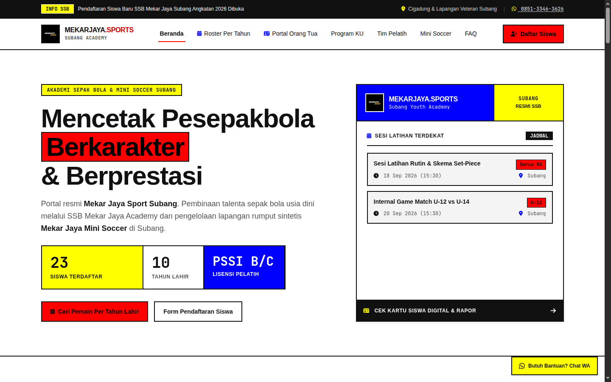
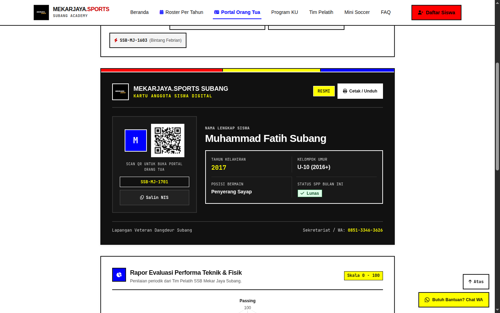
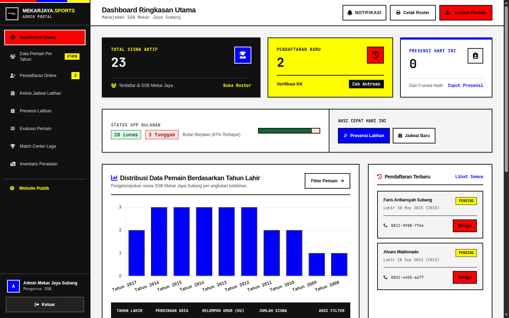
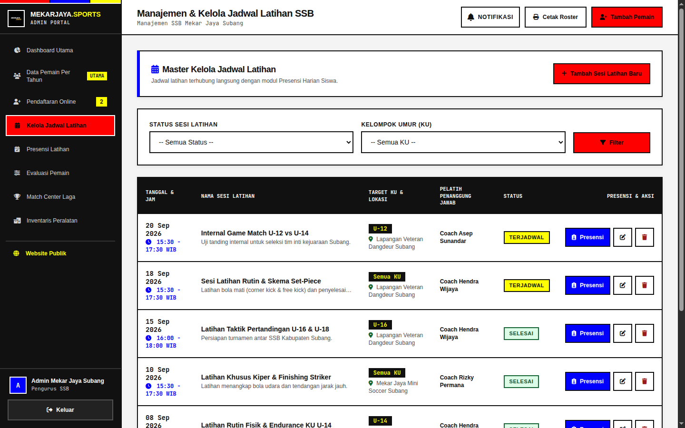
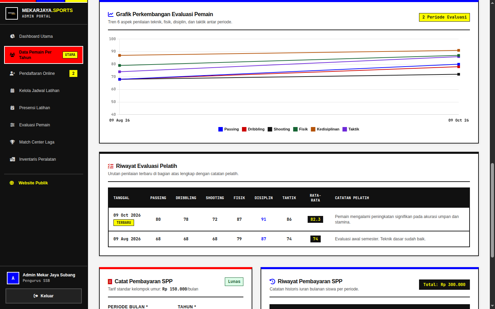
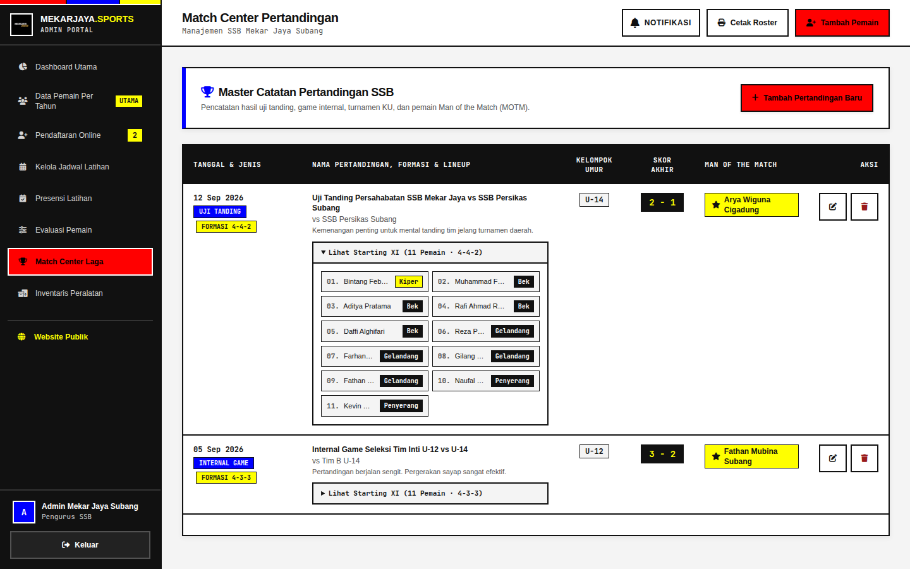

<div align="center">

  

  # SSB MEKAR JAYA & MINI SOCCER SUBANG
  ### Sistem Informasi Akademi Sepak Bola & Informasi Tarif Lapangan Mini Soccer

  [](https://laravel.com)
  [](https://php.net)
  [](https://tailwindcss.com)
  [](https://mysql.com)
  [](LICENSE)

</div>

---

## Deskripsi Proyek

**Sistem Informasi SSB Mekar Jaya & Mini Soccer Subang** adalah aplikasi web untuk mengelola operasional Sekolah Sepak Bola (SSB) Mekar Jaya Kabupaten Subang serta menampilkan informasi tarif penyewaan lapangan Mini Soccer. Sistem ini mempermudah pendataan siswa berdasarkan Kelompok Umur (`U-10` s.d. `U-18`) dan tahun kelahiran (`2008` s.d. `2018`), integrasi jadwal latihan dengan presensi, pemantauan perkembangan skill jangka panjang, riwayat SPP bulanan, kartu siswa digital ber-QR Code, Match Center dengan susunan 11 pemain inti, hingga notifikasi internal pengurus dan pelatih.

Antarmuka aplikasi menerapkan gaya desain **De Stijl Abstrato** dengan struktur grid tegas, permukaan terang (`#FFFFFF` / `#F4F4F4`), garis batas `2px solid #111111`, sudut `0px`, dan warna primer `#FF0000`, `#0000FF`, serta `#FFFF00`.

---

## Tampilan Antarmuka (Terbaru)

### 1. Landing Page Publik & Portal Akademi

*Halaman utama publik dengan navigasi, informasi pendaftaran siswa baru, jadwal latihan terdekat, statistik akademi, dan tautan Portal Orang Tua.*

### 2. Kartu Siswa Digital & QR Code (Portal Orang Tua)

*Kartu identitas siswa digital dilengkapi QR Code SVG siap cetak menuju Portal Orang Tua beserta status SPP bulan berjalan.*

### 3. Admin Dashboard & Lonceng Notifikasi

*Ringkasan total siswa aktif, verifikasi pendaftar baru, presensi harian, status SPP bulanan dinamis, grafik sebaran tahun lahir, dan tombol notifikasi sistem.*

### 4. Kelola Jadwal Latihan & 1-Click Presensi

*Daftar jadwal latihan per Kelompok Umur dengan tombol cepat Presensi yang memperbarui status sesi menjadi selesai setelah disimpan.*

### 5. Grafik Progres Evaluasi & Riwayat SPP Bulanan

*Line Chart perkembangan 6 aspek performa antar periode, riwayat catatan pelatih, serta pencatatan & buku besar SPP bulanan per siswa.*

### 6. Match Center & Skuad Pertandingan (Inti + Cadangan)

*Catatan hasil pertandingan beserta formasi taktik (`4-3-3`, `4-4-2`, `3-5-2`, `4-2-3-1`, `5-3-2`), 11 pemain inti (Starting XI), dan daftar pemain cadangan.*

---

## Fitur Utama (Sesuai Implementasi Kode)

### 1. Portal Publik & Orang Tua (`/`, `/portal-ortu`)
* **Landing Page Akademi & Roster Publik**: Pencarian dan filter pemain aktif berdasarkan Kelompok Umur (`U-10`, `U-12`, `U-14`, `U-16`, `U-18`), tahun lahir, dan nama/NIS.
* **Pendaftaran Siswa Baru Online (`POST /register-siswa`)**: Formulir mandiri dengan unggah dokumen Kartu Keluarga (KK) terkompresi otomatis (`ImageCompressionService`), persetujuan Syarat & Ketentuan, FAQ privasi berkas KK, serta notifikasi otomatis ke admin.
* **Portal Orang Tua (`/portal-ortu`)**: Pencarian kartu siswa digital dan status perkembangan anak menggunakan NIS atau nomor WhatsApp wali, lengkap dengan QR Code SVG siap cetak.
* **Informasi Tarif Mini Soccer**: Penayangan daftar tarif lapangan weekday/weekend (`MiniSoccerRate`) dan tombol pesan langsung via WhatsApp (tanpa sistem booking kalender online maupun payment gateway).
* **Akses Login Terpadu (`/login`)**: Halaman login terpisah tanpa tombol admin yang menonjol di navigasi pengunjung publik.

### 2. Portal Pengurus & Pelatih (`/admin`)
* **Kontrol Akses Berbasis Role (`admin` & `coach`)**:
  * **Admin (`admin`)**: Akses penuh ke Dashboard, Data Pemain Per Tahun & Rapor, Verifikasi Pendaftaran Online, Riwayat Pembayaran SPP Bulanan, Inventaris Peralatan, Jadwal Latihan, Presensi, Evaluasi Pemain, Match Center, dan Notifikasi.
  * **Pelatih (`coach`)**: Fokus pembinaan lapangan dengan akses ke Dashboard, Jadwal Latihan, Presensi Latihan, Evaluasi Pemain, Match Center, dan Notifikasi (rute sensitif seperti Data Pemain/SPP/Pendaftaran/Inventaris dibatasi `403 Forbidden`).
* **Kartu Siswa Digital & Rapor Cetak dengan QR Code (`simple-qrcode`)**:
  * QR Code SVG terintegrasi langsung pada kartu detail pemain (`/admin/players/{id}`), Portal Orang Tua (`/portal-ortu`), dan Rapor Periodik (`/admin/players/{id}/print-rapor`) yang ikut tercetak pada tampilan `@media print`.
* **Riwayat Pembayaran SPP Bulanan (`spp_payments`)**:
  * Pencatatan pembayaran berperiode bulan dan tahun dengan nominal default berdasarkan tarif Kelompok Umur, metode (`tunai`/`transfer`), pencegahan duplikasi periode, penghapusan catatan, serta sinkronisasi otomatis status SPP bulan berjalan.
* **Riwayat Evaluasi Performa & Grafik Progres**:
  * Penyimpanan riwayat evaluasi bertanggal tanpa menimpa penilaian terdahulu, disertai **Radar Chart** profil kemampuan terkini dan **Line Chart** perkembangan 6 aspek teknik/taktik/disiplin dari waktu ke waktu (`Chart.js`).
* **Match Center, Formasi & Skuad Lengkap (Inti + Cadangan)**:
  * Pencatatan hasil pertandingan lengkap dengan pilihan formasi (`4-3-3`, `4-4-2`, `3-5-2`, `4-2-3-1`, `5-3-2`), validator `11 pemain inti unik` dengan tepat `1 Kiper`, serta daftar dinamis pemain cadangan (hingga 15 pemain).
* **Notifikasi In-App & Pengingat Latihan H-1**:
  * Tabel `notifications` untuk pendaftaran baru, perubahan status pendaftaran (lengkap dengan template pesan WhatsApp siap salin/kirim untuk orang tua), dan pengingat latihan H-1 ke Admin dan Pelatih via command `php artisan app:send-training-reminders` (terjadwal harian pukul `07:00`).

---

## Teknologi yang Digunakan

* **Back-End**: Laravel `13.x` (`laravel/framework ^13.17`), PHP `^8.3`
* **Front-End**: Blade Templates, Tailwind CSS `^4.0` (`@tailwindcss/vite`), Vite `^8.0`, FontAwesome `6.5.1`, Chart.js
* **QR Code Generator**: `simplesoftwareio/simple-qrcode` `^4.2` (output SVG inline tanpa ketergantungan `ext-gd` saat render)
* **Database**: MySQL `8.0+` (pengembangan/produksi) & SQLite `:memory:` (pengujian otomatis PHPUnit)
* **Pengujian**: PHPUnit `^12.5` dengan Laravel `RefreshDatabase`

---

## Panduan Instalasi & Pengujian Lokal

### 1. Prasyarat Sistem
* PHP >= 8.3
* Composer >= 2.x
* Node.js >= 18.x & NPM
* MySQL Database (XAMPP / LAMPP / Docker / lokal)

### 2. Instalasi Dependensi
```bash
composer install
npm install
```

### 3. Konfigurasi Environment (`.env`)
```bash
cp .env.example .env
php artisan key:generate
```
Sesuaikan koneksi MySQL pada `.env`:
```env
DB_CONNECTION=mysql
DB_HOST=127.0.0.1
DB_PORT=3306
DB_DATABASE=mekarjaya_db
DB_USERNAME=root
DB_PASSWORD=
```

### 4. Migrasi & Seeder Data Awal
```bash
php artisan storage:link
php artisan migrate:fresh --seed
```

### 5. Build Aset & Jalankan Server
```bash
npm run build
php artisan serve
```
Akses aplikasi di `http://127.0.0.1:8000`.

### 6. Menjalankan Scheduler Pengingat Latihan H-1 & Tes Otomatis
```bash
# Eksekusi manual command pengingat jadwal latihan besok (H-1)
php artisan app:send-training-reminders

# Menjalankan seluruh rangkaian Feature & Unit Test (SQLite :memory:)
php artisan test
```

---

## Kredensial Login Demo (Seeder)

Setelah menjalankan `php artisan migrate:fresh --seed`, akun berikut tersedia pada halaman `/login`:

| Peran (Role) | Email | Password | Hak Akses Utama |
| :--- | :--- | :--- | :--- |
| **Admin** (`admin`) | `admin@mekarjaya.com` | `password` | Akses penuh seluruh modul manajemen SSB |
| **Pelatih** (`coach`) | `coach@mekarjaya.com` | `password` | Jadwal latihan, presensi, evaluasi siswa, match center |

---

## Struktur Direktori Utama

```text
mekarjaya/
├── app/
│   ├── Console/Commands/         # SendTrainingReminders (pengingat H-1 terjadwal)
│   ├── Http/
│   │   ├── Controllers/          # Home, Admin, Player, Registration, Attendance,
│   │   │                         # Evaluation, Schedule, Inventory, Match, Notification
│   │   └── Middleware/           # RoleMiddleware ('role' alias)
│   ├── Models/                   # User, Player, Registration, AgeCategory, TrainingSchedule,
│   │                             # Attendance, Evaluation, SppPayment, Coach, Inventory,
│   │                             # MatchModel, MiniSoccerRate
│   ├── Notifications/            # NewRegistration, RegistrationStatusUpdated, TrainingReminder
│   └── Services/                 # ImageCompressionService
├── database/
│   ├── migrations/               # Skema tabel aplikasi + roles, spp_payments, notifications
│   └── seeders/                  # DatabaseSeeder (akun admin/coach, KU, siswa, SPP, match)
├── resources/
│   ├── css/app.css               # Tailwind v4 + token gaya De Stijl Abstrato + aturan @media print
│   └── views/                    # Layouts (public, admin), views modul admin & portal orang tua
├── routes/
│   ├── web.php                   # Rute publik & grup rute role:admin,coach / role:admin
│   └── console.php               # Penjadwalan harian command app:send-training-reminders
└── tests/
    └── Feature/                  # Feature tests (Auth/Role, Pendaftaran, Presensi, Evaluasi,
                                  # SPP, Lineup Match, Notifikasi H-1)
```

---

## Lisensi

Hak Cipta 2026 **SSB Mekar Jaya & Mini Soccer Subang**. Dirilis di bawah lisensi [MIT](LICENSE).
